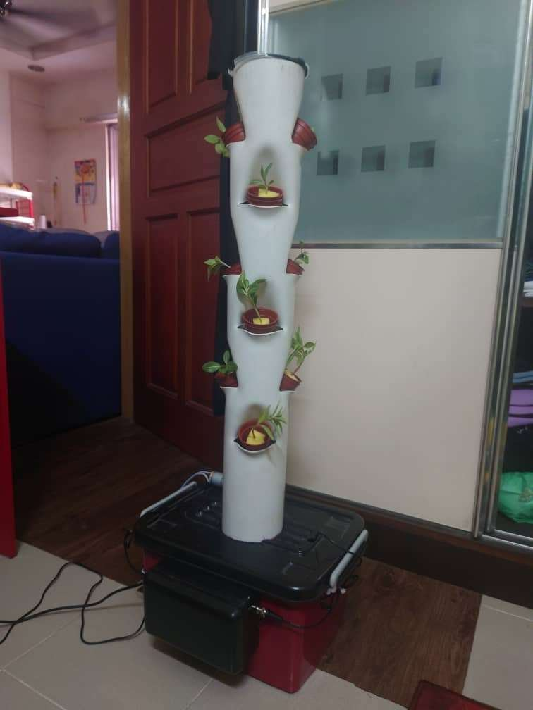
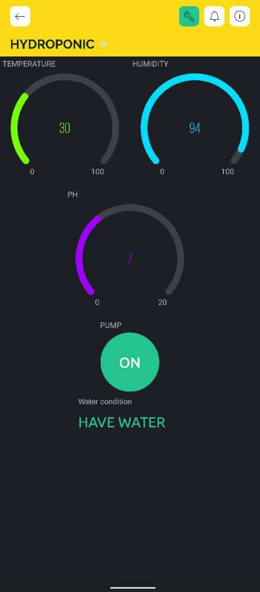
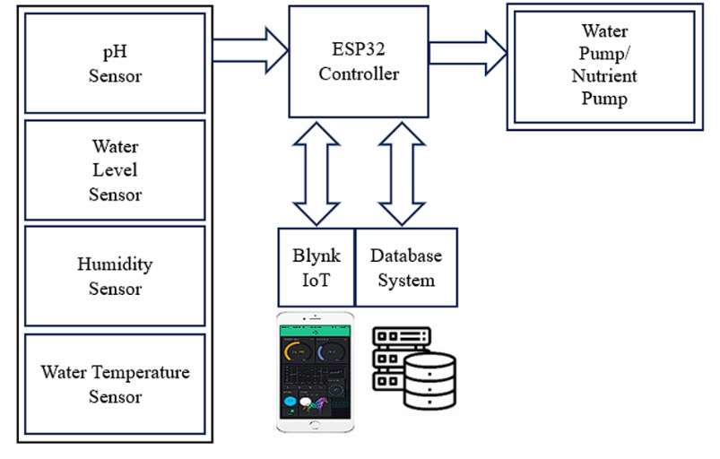
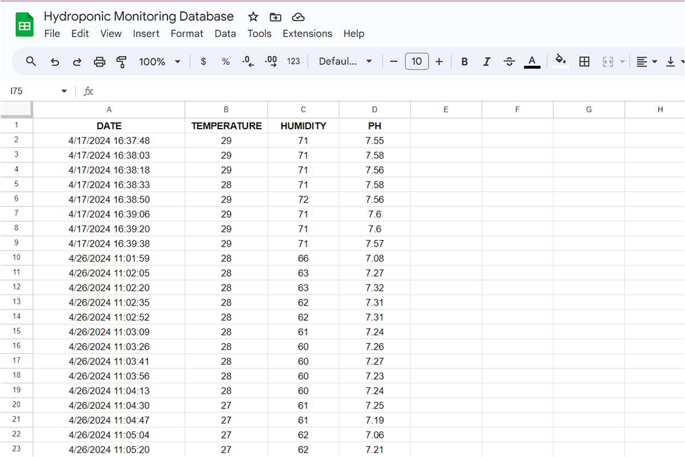
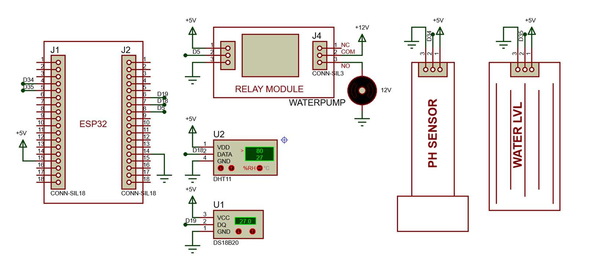

# Smart Hydroponic Monitoring System (ESP32 + Blynk)

IoT system that monitors a hydroponic setup in real time and lets you control the water pump from your phone. Diploma final year project, featured in the 2024 FYP Extended Abstracts (Department of Electrical Engineering, Politeknik Seberang Perai).

 

---

## Problem

In conventional hydroponic farming, pH, temperature and water levels are checked by hand. Mistakes waste water and nutrients and affect plant growth.

## Features

- **pH monitoring** with noise filtering (10 samples, median-averaged) and calibration
- **Water temperature** (DS18B20) plus **air temperature and humidity** (DHT11)
- **Water level status** shown in the app ("HAVE WATER" / "NO WATER")
- **Remote pump control** from the Blynk Android app
- **Automatic data logging** to Google Sheets every 15 seconds

## How It Works

1. The ESP32 reads the pH, water temperature, DHT11 and water level sensors
2. Live readings are sent to the Blynk app
3. The user switches the water pump on or off from the app
4. Every 15 seconds, readings are sent to a Google Apps Script web app, which saves them to Google Sheets

## Hardware

- ESP32
- pH sensor
- DS18B20 waterproof temperature sensor
- DHT11 temperature and humidity sensor
- Water level sensor
- Water pump + 2-channel relay

## Tech Stack

- Arduino C++ (ESP32)
- Blynk IoT (Android app)
- Google Apps Script + Google Sheets
- Proteus (schematic)

## Files

- `firmware/smart_hydroponic/smart_hydroponic.ino`: ESP32 firmware. Fill in your Blynk template ID and auth token, Wi-Fi details and Apps Script deployment ID.

## Project Info

- **Course:** Final Year Project, Diploma in Electronic Engineering (Computer), Politeknik Seberang Perai (Session 2 2023/2024)
- **Type:** Individual project

## Future Improvements

- Optimised nutrient delivery for specific plants
- Closed-loop system that recycles water and nutrients
- Solar power for lower running costs
